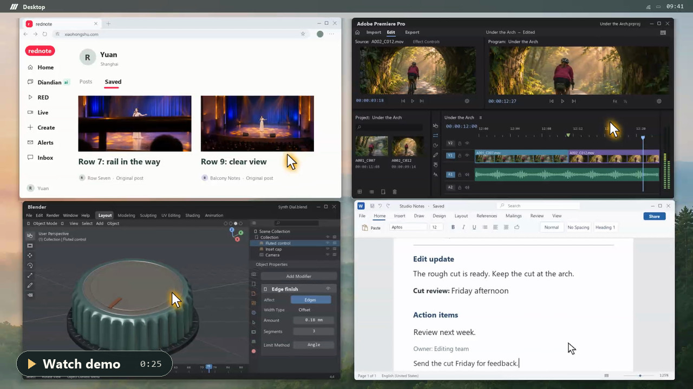
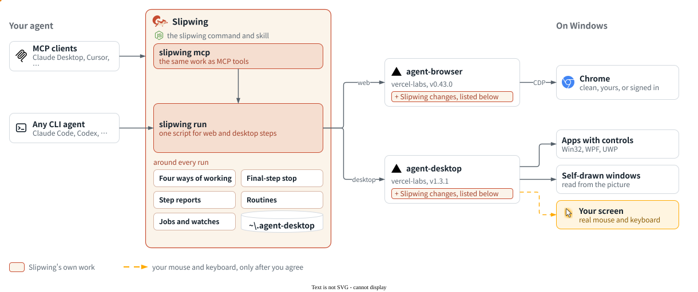

[English](README.md) | [简体中文](README.zh-CN.md)

# Slipwing

Slipwing is an independent Windows build of [vercel-labs/agent-desktop](https://github.com/vercel-labs/agent-desktop)
and [vercel-labs/agent-browser](https://github.com/vercel-labs/agent-browser). It hands your AI agent your desktop apps
and your browser, and leaves you the mouse.

[](../assets/Videos/slipwing-en.mp4?raw=true)

## What your agent can do

- **Work while you work.** It fills fields, presses buttons and picks options in windows you are not looking at. The
  window you type in stays in front.
- **Use your Chrome.** Your sign-ins, in a tab of its own, with your open tabs left alone.
- **Go from page to app in one call.** Read it on a website, enter it in a desktop app: one script, run once. A
  six-field web form is filled and submitted in 0.71 s.
- **Handle self-drawn apps.** Windows with no controls to read are read from their pixels, and clicks go in the
  background first.
- **Send once.** Send, submit, pay and delete wait for your yes in the chat. A click that may have landed is checked
  before anything else is sent.
- **Learn a task once.** Save what worked under a name and ask for it again with new values. Eight repeated tasks went
  from 360 s to 189 s.
- **Wait for the moment.** When the render finishes, the download lands or a window says done, it carries on.
- **Look human on camera.** For demos and tutorials, the pointer glides and keys land at a human pace.
- **Plug into any agent.** Anything that runs commands learns Slipwing from `slipwing skill`. Anything that speaks
  MCP gets the same work as tools.



## Quick start

Windows 10 or 11 (x64) with [Node.js](https://nodejs.org) 22 or later. In PowerShell:

```powershell
npm install -g slipwing --allow-scripts=slipwing
```

This adds the `slipwing` command. Any agent that can run commands learns it from `slipwing skill`; the installer also
registers it as a skill with Claude Code and Codex, and `slipwing skill --install --dir FOLDER` adds it to any other
agent's skill folder. Official `agent-desktop` and `agent-browser` installs stay as they are. Restart your agent and
try:

> Use slipwing. Look up tomorrow's weather in my Chrome and add it as a new line in the open Notepad window. Don't touch
> my mouse.

Or paste this to your agent:

```text
Install Slipwing (https://github.com/narmi924/slipwing) for me: run
npm install -g slipwing --allow-scripts=slipwing
then run slipwing skill and use it from now on.
```

- **Your own Chrome:** turn on remote debugging once at `chrome://inspect/#remote-debugging`. After each restart, Chrome
  asks you to allow the first connection.
- **MCP clients** such as Claude Desktop or Cursor:
  `{ "mcpServers": { "slipwing": { "command": "cmd", "args": ["/c", "slipwing", "mcp"] } } }`
- **Your data** stays in `%USERPROFILE%\.agent-desktop`: routines, preferences and job records. Delete it to start over.
- **Uninstall:** `npm uninstall -g slipwing`, then delete the `slipwing` folders under `%USERPROFILE%\.claude\skills`
  and `%USERPROFILE%\.codex\skills`.

## Usage

Tell your agent what you want. These words change how it works:

| You say | It does |
|---|---|
| nothing about how | works in the background, in a browser you don't see |
| "use my browser" | your signed-in Chrome, in a tab of its own, still in the background |
| "let me watch" | on screen at a human pace; an amber pointer means hands off |
| "this is for a recording" | the same, with your own pointer |
| "just use the mouse" | real input where a step needs it, at full speed |
| "save this" | keeps the task to run again by name |
| "when the export finishes, upload it" | waits for that window or file, then runs the upload |
| "from now on in this project …" | remembers the way of working for that folder |

## Why Slipwing

I run coding agents on the Windows PC I work on, and I wanted them to run errands in my browser and desktop apps
without taking my mouse. Vercel's two tools were the right base, so I built on them and added what I was missing.

| Tool | What it does well | What it lacks |
|---|---|---|
| [Codex Computer Use](https://developers.openai.com/codex/app/computer-use), [Claude computer use](https://code.claude.com/docs/en/desktop#let-claude-use-your-computer) | built into the app, works from screenshots on any window | takes the pointer and the foreground on Windows |
| [Windows-MCP](https://github.com/CursorTouch/Windows-MCP), [Hybrid Computer Use](https://github.com/microsoft/Hybrid-Computer-Use) | read UI Automation, any model through MCP | click and type with the real mouse and keyboard |
| [agent-desktop](https://github.com/vercel-labs/agent-desktop), [agent-browser](https://github.com/vercel-labs/agent-browser) | background actions through UI Automation and the Chrome DevTools Protocol | no task that spans both; on Windows, typing, drag and right-click need the screen; background actions can pull a window to the front ([#567](https://github.com/vercel-labs/agent-desktop/issues/567)) |
| [Sidehand](https://github.com/Blue-B/sidehand) | leaves your window in front, works with any MCP client, fast on desktop apps | web pages only through the browser window, no `<select>` in the background, no saved tasks |

## What it adds to the Vercel tools

### agent-desktop

- Background actions leave the window you are using in front. In three runs, a note in front received every character
  typed into it: 58 of 58, 55 of 55, 51 of 51.
- Windows that draw their own interface are read from their picture and clicked in the background.
- Typing under input methods such as Microsoft Pinyin keeps every character in order.
- A human-paced pointer and typing, an amber pointer while the agent has the mouse, and a pause when you touch it.
- Reports what changed after an action, checks that a save really changed the file, and waits until you stop typing.
- Clicks the visible part of a partly covered control, opens installed apps by name and reads the selected text.
- Reads large windows faster by fetching a node's children in one call.

### agent-browser

- Works in your running Chrome in a tab of its own and leaves your other tabs alone.
- Clicks in background tabs return in 75 ms instead of about 5 s.
- Real key events for fields that ignore inserted text.
- Finds fields with no label by the text next to them.
- Clicks land inside nested frames, on CSS carousel buttons and on partly covered targets.
- Every command that changes the page says what happened: a new address, a new tab or a dialog.
- A human-paced pointer and typing.

### The `slipwing` command

- One script with web and desktop steps, run in one call. Reading a page takes 0.27 s and a desktop window 0.3 to
  0.56 s (Windows 11, fastest of seven runs).
- Three browsers: a clean one by default, your signed-in Chrome, or a profile the agent signs in to once.
- Four ways of working: background by default, watch, record and direct, remembered per request, routine, project
  folder or everywhere.
- Send, submit, pay and delete steps wait until you agree in the chat.
- A click that may have landed is checked before another one, and work stops when Windows keeps another window in front.
- Routines, jobs that keep running in the background, and watches that wait for a window, a line of text, a
  notification or a file.
- Works with any agent: a guide that any agent with a shell reads from `slipwing skill`, and an MCP server for the
  rest.

## Thanks

Slipwing exists because Vercel Labs released agent-desktop and agent-browser as open source. Thank you to their
maintainers and contributors. Fixes that belong upstream go back as pull requests to
[agent-desktop](https://github.com/vercel-labs/agent-desktop/pulls?q=author%3Anarmi924) and
[agent-browser](https://github.com/vercel-labs/agent-browser/pulls?q=author%3Anarmi924).

Slipwing is not affiliated with or endorsed by Vercel. Please report Slipwing problems here, not upstream.
`slipwing --version` prints the upstream commits this build is based on. The agent-browser changes live in
[narmi924/agent-browser](https://github.com/narmi924/agent-browser).

## License

Apache-2.0, as the two upstream projects. Their license files are kept, and every change is in this repository's
history.
