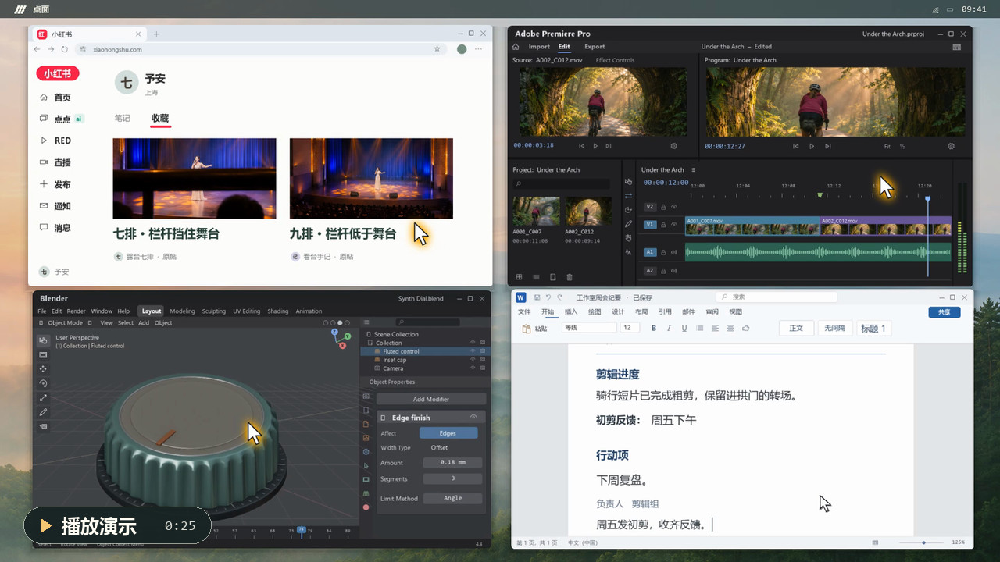
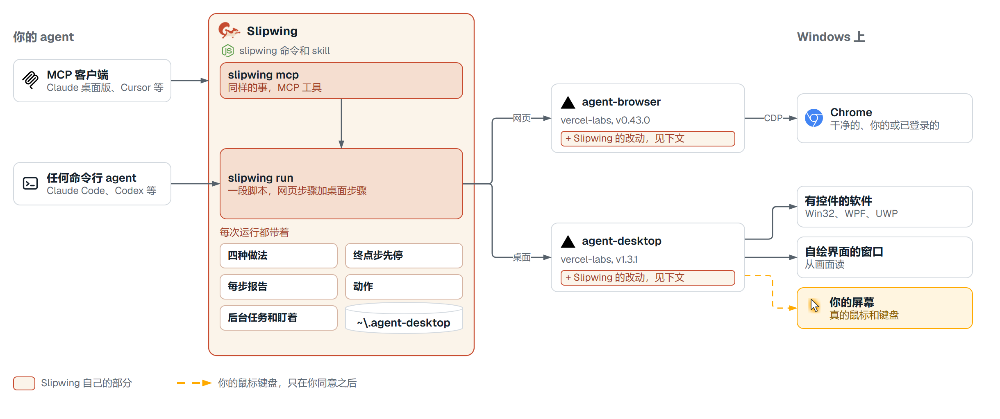

[English](README.md) | [简体中文](README.zh-CN.md)

# Slipwing

Slipwing 是基于 [vercel-labs/agent-desktop](https://github.com/vercel-labs/agent-desktop) 和
[vercel-labs/agent-browser](https://github.com/vercel-labs/agent-browser) 独立制作的 Windows 版本。它把你的桌面软件和浏览器交给
AI agent，鼠标留给你。

[](../assets/Videos/slipwing-zh.mp4?raw=true)

## 能做什么

- **你干你的，它干它的。** 在你没看的窗口里填字段、按按钮、选选项，你打字的窗口一直在前台。
- **就用你的 Chrome。** 带着你的登录状态，在自己的标签页里做事，不碰你开着的页面。
- **网页到桌面，一次做完。** 在网站上读，在桌面软件里填，一段脚本跑一次。一张 6 项的网页表，填完提交 0.71 秒。
- **自绘界面也拿得下。** 没有控件可读的窗口，从画面里读字，点击先在后台送过去。
- **只发一次。** 发送、提交、付款、删除，等你在对话里点头才做。可能已经点到的按钮，先核对，再决定下一步。
- **教一次就会。** 做成过的事存个名字，下次换个值叫名字就行。8 件重复的事从 360 秒降到 189 秒。
- **到点接着干。** 渲染完了、下载到了、窗口显示完成了，它接着往下做。
- **录屏像真人。** 做演示和教程时，光标顺滑移动，按键按真人的节奏落下。
- **什么 agent 都能接。** 能跑命令的，用 `slipwing skill` 就学会怎么用；支持 MCP 的，拿到的是同一套工具。



## 快速开始

需要 Windows 10 或 11（x64），以及 [Node.js](https://nodejs.org) 22 或更新版本。在 PowerShell 里运行：

```powershell
npm install -g slipwing --allow-scripts=slipwing
```

它会装上 `slipwing` 命令。能跑命令的 agent 都可以从 `slipwing skill` 学会用法；安装时还会顺手登记到 Claude Code 和 Codex 的 skill 目录，别的 agent 用 `slipwing skill --install --dir 它的skill目录` 加进去。已经装了官方 `agent-desktop` 或 `agent-browser` 的，原来的不受影响。重启 agent，试试这句：

> 用 slipwing。在我的 Chrome 里查一下明天的天气，写到开着的记事本里新的一行，别动我的鼠标。

也可以把下面这段直接发给 agent：

```text
帮我装 Slipwing（https://github.com/narmi924/slipwing ）：运行
npm install -g slipwing --allow-scripts=slipwing
然后运行 slipwing skill，以后照着它用。
```

- **用你自己的 Chrome：** 在 `chrome://inspect/#remote-debugging` 打开远程调试，只做一次。之后每次重启 Chrome，第一次连接时 Chrome 会请你点一下允许。
- **接进 MCP 客户端**（Claude 桌面版、Cursor 等）：
  `{ "mcpServers": { "slipwing": { "command": "cmd", "args": ["/c", "slipwing", "mcp"] } } }`
- **你的数据** 都在 `%USERPROFILE%\.agent-desktop`：动作、偏好、任务记录。删掉这个文件夹就回到初始状态。
- **卸载：** 运行 `npm uninstall -g slipwing`，再删掉 `%USERPROFILE%\.claude\skills` 和 `%USERPROFILE%\.codex\skills` 下的 `slipwing` 文件夹。

## 用法

直接告诉 agent 你要什么。下面这些话会改变它的做法：

| 你说 | 它怎么做 |
|---|---|
| 没说怎么做 | 在后台、在一个你看不见的浏览器里做 |
| “用我的浏览器” | 在你已登录的 Chrome 里单开一个标签页，照样在后台 |
| “让我看着做” | 在屏幕上按真人的节奏做，琥珀色光标提醒你别碰 |
| “这是要录屏的” | 同上，光标保持你原来的样子 |
| “直接用鼠标就行” | 需要的步骤直接用键鼠，不放慢 |
| “存下来” | 存成一个动作，以后叫名字就能再做 |
| “导出完了就上传” | 等那个窗口或文件出现，再跑上传 |
| “这个项目以后都……” | 记住这个项目文件夹用哪种做法 |

## 为什么做

我在自己干活的 Windows 电脑上用写代码的 agent，想让它们在浏览器和桌面软件里替我跑腿，又不抢我的鼠标。Vercel 的这两个工具是对的起点，我就在它们上面补齐了我需要的部分。

| 工具 | 它做得好的 | 它缺少的 |
|---|---|---|
| [Codex 的 Computer Use](https://developers.openai.com/codex/app/computer-use)、[Claude 的电脑操控](https://code.claude.com/docs/en/desktop#let-claude-use-your-computer) | 应用自带，看截图，什么窗口都能操作 | 在 Windows 上要占用鼠标和前台 |
| [Windows-MCP](https://github.com/CursorTouch/Windows-MCP)、[Hybrid Computer Use](https://github.com/microsoft/Hybrid-Computer-Use) | 读 UI 自动化，通过 MCP 什么模型都能用 | 点击和打字用的是真的鼠标键盘 |
| [agent-desktop](https://github.com/vercel-labs/agent-desktop)、[agent-browser](https://github.com/vercel-labs/agent-browser) | 通过 UI 自动化和 Chrome 调试协议在后台操作 | 一件事不能同时用上两个；在 Windows 上打字、拖拽、右键都要占屏幕；后台操作可能把窗口拉到前台（[#567](https://github.com/vercel-labs/agent-desktop/issues/567)） |
| [Sidehand](https://github.com/Blue-B/sidehand) | 不动你前台的窗口，任何 MCP 客户端都能用，桌面软件上很快 | 网页只能通过浏览器窗口操作，后台选不了 `<select>` 下拉框，做过的事存不下来 |

## 比官方多了什么

### agent-desktop

- 后台操作时，你正在用的窗口留在前台。连跑三次，前台笔记窗口收到的字一个不少：58/58、55/55、51/51。
- 自己绘制界面的窗口，从画面里读字，点击也在后台送过去。
- 在微软拼音这类输入法下打字，字不丢、顺序不乱。
- 按真人节奏移动光标和打字；agent 用着鼠标时光标变成琥珀色，你一碰鼠标键盘它就暂停。
- 每次操作后报出改了什么，确认保存真的写进了文件，等你停下打字再动手。
- 控件被挡住一部分时点露出来的那部分；按名字打开已安装的软件；读出选中的文字。
- 一次取回一个节点的全部子控件，读大窗口更快。

### agent-browser

- 在你正开着的 Chrome 里单开一个标签页做事，不碰你原来的标签页。
- 后台标签页里的点击 75 毫秒返回，原来要等 5 秒左右。
- 对不认插入文字的输入框，发真实的按键。
- 没有标签的输入框，按旁边的文字找到它。
- 点嵌套框架里的按钮、CSS 轮播按钮、被挡住一部分的目标，都能点准。
- 每个改动页面的命令都报出结果：换了网址、开了新标签页，还是弹了对话框。
- 按真人节奏移动光标和打字。

### `slipwing` 命令

- 网页步骤和桌面步骤写进一段脚本，一次调用做完。读一个网页 0.27 秒，读一遍桌面窗口 0.3 到 0.56 秒（Windows 11，7 次取最快）。
- 三种浏览器：默认是干净的浏览器，也可以用你已登录的 Chrome，或者 agent 自己登录过一次的专用浏览器。
- 四种做法：默认后台，另有看着做、录屏、直接操作；可以按这一次、按动作、按项目文件夹或者所有地方记住。
- 发送、提交、付款、删除这几步，等你在对话里同意才做。
- 一次点击可能已经送到时，先核对再决定要不要再点；Windows 不肯把你的窗口还回前台时，停下来不打字。
- 动作、后台任务，以及等某个窗口、某行字、某条通知或某个文件出现再接着做的“盯着”。
- 什么 agent 都能用：能跑命令的从 `slipwing skill` 读用法，不能跑命令的接 MCP 服务。

## 致谢

Slipwing 能做出来，是因为 Vercel Labs 把 agent-desktop 和 agent-browser 开源了。感谢两个项目的维护者和贡献者。适合上游的修复会以 PR 的形式提回去：[agent-desktop](https://github.com/vercel-labs/agent-desktop/pulls?q=author%3Anarmi924)、[agent-browser](https://github.com/vercel-labs/agent-browser/pulls?q=author%3Anarmi924)。

Slipwing 与 Vercel 没有隶属关系，也没有得到 Vercel 的背书。Slipwing 的问题请在这里提，不要提到上游。`slipwing --version` 会打出这个版本基于的上游提交。agent-browser 的改动在 [narmi924/agent-browser](https://github.com/narmi924/agent-browser)。

## 许可证

Apache-2.0，和两个上游项目一致。上游的许可证文件都保留着，每一处改动都在这个仓库的提交历史里。
